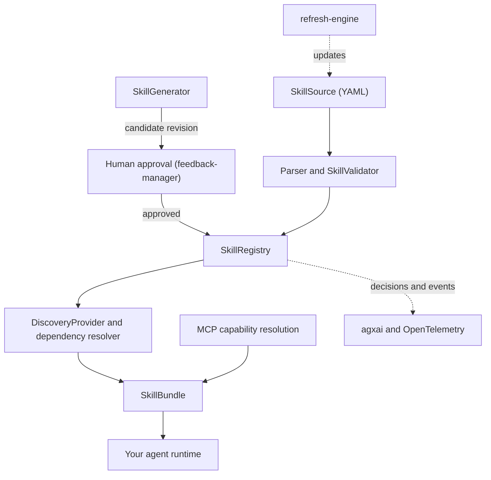

# Architecture

The manager coordinates lifecycle policy. Generators supply candidates;
feedback-manager records reviews; refresh-engine updates external resources;
agxai and OTel receive decisions and events.

Core imports no optional framework. Optional implementations live in explicit
modules. Models are frozen, extra-forbid Pydantic data. I/O and extension methods
are async; filesystem/YAML work runs in threads where needed.

Writes to the same Skill are serialized, in-process caches and error histories
are bounded, and a failing source does not stop the others. PostgreSQL storage
additionally guarantees a single active revision per Skill across processes.

Application-created collaborators are application-owned. Separate services use
compensation rather than one transaction. Restart-safe review needs durable
registry and feedback storage.
